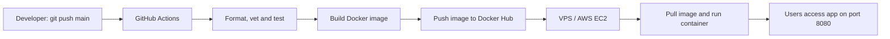

# DevOps Assessment

A minimal Go HTTP service packaged in a non-root, multi-stage Docker image, checked and published with GitHub Actions, plus a Linux system-health script.

## Project structure

.
├── .github/
│   └── workflows/
│       └── ci.yml
├── .dockerignore
├── Dockerfile
├── README.md
├── compose.yaml
├── go.mod
├── main.go
└── system_health.sh


## 1. Application

The service listens on port `8080`. A `GET /` request returns:

```json
{
  "message": "Hello from DevOps Intern Task!",
  "status": "running"
}
```

Run locally with Go (1.23 or later):

```bash
go run .
```

In another terminal:

```bash
curl http://localhost:8080/
```

## 2. Run with Docker Compose

Requirements: Docker Engine and the Docker Compose plugin.

From the repository root:

```bash
docker compose up --build -d
```

Verify the endpoint:

```bash
curl http://localhost:8080/
```

View logs:

```bash
docker compose logs -f
```

Stop and remove the container:

```bash
docker compose down
```

The container listens on port `8080`, runs as UID/GID `65532`, has a read-only root filesystem, drops Linux capabilities, and disallows privilege escalation. The final image uses `scratch`, so it contains only the compiled application binary.

## 3. Linux system-health script

The script uses Linux `/proc` files and `df`. It measures CPU usage over a one-second sample, calculates memory usage using `MemAvailable`, and reports disk usage for the root filesystem.

Make it executable and run it:

```bash
chmod +x system_health.sh
./system_health.sh
```

Each run appends a timestamped record to `health_log.txt` beside the script. If root filesystem usage is above 80%, it also prints and logs:

```text
[WARNING] Disk space high!
```

You can inspect the log with:

```bash
cat health_log.txt
```

## 4. GitHub Actions CI/CD

The workflow at `.github/workflows/ci.yml` runs on every push to `main`.

It performs:
1. Go formatting validation (`gofmt`).
2. Static analysis (`go vet`) and tests (`go test`).
3. A Docker image build to catch Dockerfile/build errors.
4. After checks pass, logs in to Docker Hub and publishes both `latest` and the commit-SHA image tags.

### Configure Docker Hub publishing

1. Create a public repository named `devops-intern-task` on Docker Hub.
2. In the GitHub repository, open **Settings → Secrets and variables → Actions**.
3. Add these repository secrets:
   - `DOCKERHUB_USERNAME`: your Docker Hub username.
   - `DOCKERHUB_TOKEN`: a Docker Hub access token with read/write permission.
4. Push this project to the GitHub repository's `main` branch.

The published image will be available as:

```text
docker.io/YOUR_DOCKERHUB_USERNAME/devops-intern-task:latest
```

Replace `YOUR_DOCKERHUB_USERNAME` with your actual Docker Hub username. Never commit credentials or access tokens to the repository.

## 5. End-to-end workflow



## 6. How would you deploy this container to AWS EC2 or another VPS?

- **Provision and secure the server:** Launch an Ubuntu EC2 instance (or VPS), allow SSH only from a trusted IP, and allow inbound TCP `8080` only as needed. Install Docker Engine and the Compose plugin.
- **Pull and run the image:** On the server, authenticate to Docker Hub if required, pull `YOUR_DOCKERHUB_USERNAME/devops-intern-task:latest`, then run it with `docker run -d --name devops-app --restart unless-stopped -p 8080:8080 YOUR_DOCKERHUB_USERNAME/devops-intern-task:latest`.
- **Operate safely:** Configure a domain and HTTPS reverse proxy (for example, Nginx with Let's Encrypt), keep secrets out of the image, monitor logs/resource usage, and update by pulling a new image and recreating the container. For a real production setup, deploy an immutable commit-SHA tag rather than relying on `latest`.


